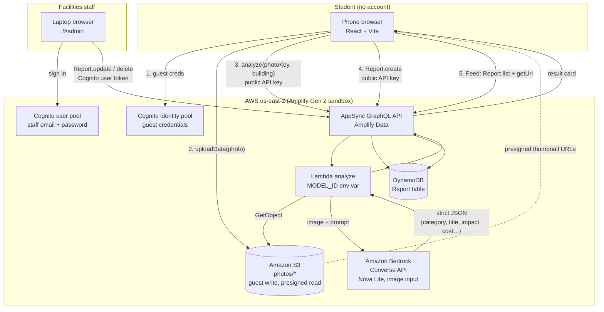

# FixIt Bobcat — Architecture

Everything runs in **us-east-2**. The app is a single React + Vite + TypeScript page; the backend is defined in code with Amplify Gen 2 and deployed from `npx ampx sandbox`. There is no server to run.

## Request flow

Step by step:

1. The browser gets temporary guest credentials from the Cognito identity pool. This is what lets a student with no account write to S3.
2. The photo is uploaded straight to S3 under `photos/*`. Nothing passes through our own server.
3. The browser calls the `analyze` GraphQL query with the photo key and the building. AppSync invokes the Lambda. The Lambda reads the photo bytes from S3, sends them to Bedrock with the prompt through the Converse API, and parses the model's answer.
4. The student reviews the result card and submits. That is a plain `Report.create` mutation, which lands in DynamoDB.
5. The Feed lists reports newest first and asks S3 for a short-lived presigned URL per thumbnail.

Staff go through a different door. Signing in at `/#admin` returns a Cognito user pool token, and only requests carrying that token can update or delete a report.

## Hardening the model output

Nova Lite is fast but not always tidy. We saw it echo the category enum literally ("WATER|ENERGY|…") and append a stray closing brace. The Lambda therefore:

- extracts the **first balanced JSON object** from the response, ignoring braces inside strings, instead of trusting the whole body;
- checks the category against the allowed list and, if it is unusable, **infers the category from the title, description, and action text**;
- clamps the impact score and cost to sane numbers;
- returns a **safe fallback report** ("Possible issue spotted") on any failure, so the student never sees a raw error and facilities still gets a ticket.

## Authorization matrix

| Caller | Credential | Report create | Report read | Report update | Report delete | `analyze` query | S3 `photos/*` |
|---|---|---|---|---|---|---|---|
| Student / public Feed | Public API key + guest identity | ✅ | ✅ | ❌ | ❌ | ✅ | write + read |
| Signed-in staff | Cognito user pool token | ❌ | ✅ | ✅ | ✅ | ❌ | read + write |

The public key is the default auth mode, so the student app never touches a user token. The staff console switches the data client to user pool auth after sign-in. Because the public key cannot update, nothing on the student side can mark a report fixed or change a cost, which is what made the public Feed view-only.

## Why exactly three AWS services

The spec set a hard limit: three AWS services beyond hosting. **Amazon Bedrock** is the only piece that can look at a photo and write the report, so it is non-negotiable. **Amazon S3** is where the photo has to live, because the model needs the bytes and the Feed needs the thumbnail. **DynamoDB** holds the reports. Everything else (Lambda, AppSync, Cognito) is the plumbing Amplify Gen 2 generates to connect those three; we did not design around it, we just wrote `defineStorage`, `defineData`, and `defineFunction`. Three services is also why a 90-minute build finished: fewer services meant fewer IAM policies, fewer consoles, and fewer things to break on stage. The one addition, a Cognito user pool, was forced on us (Amplify Storage guest access will not deploy without an auth resource) and we turned it into the staff sign-in rather than leaving it idle.

## Model choice

| | Status on this account |
|---|---|
| `us.anthropic.claude-sonnet-4-20250514-v1:0` (spec default) | End-of-life on Bedrock |
| `us.anthropic.claude-sonnet-4-5-20250929-v1:0` | Exists, but every call fails until the Anthropic use-case form is submitted |
| `us.amazon.nova-lite-v1:0` (current default) | Works. Reads photos well, answers in about one second |

The model id is the `MODEL_ID` environment variable on the Lambda. Changing it in `amplify/functions/analyze/resource.ts` redeploys the sandbox automatically.

## Region note

All resources, including the Bedrock call, are in **us-east-2**. Bedrock is invoked with a cross-region inference profile id (the `us.` prefix), which is what makes vision models available from us-east-2. CDK was bootstrapped in us-east-2 once for the sandbox. This account is the new AWS experience and signs in with `aws login`, not access keys; credentials last 12 hours.
