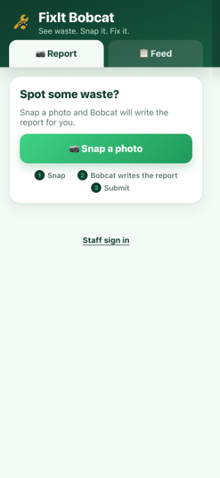
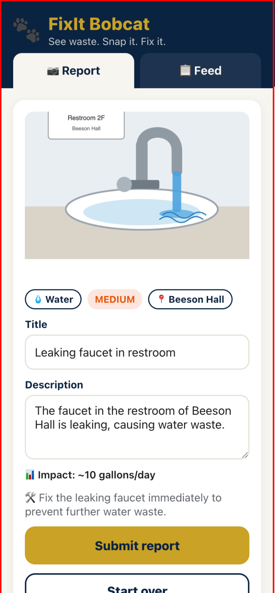
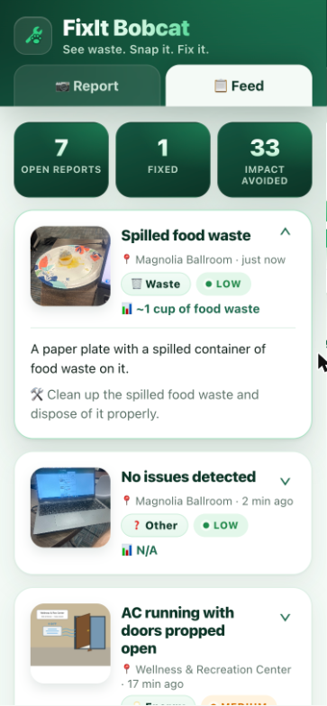
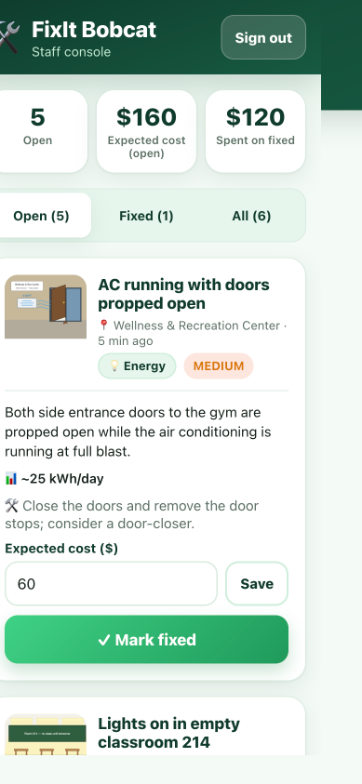

# FixIt Bobcat 🐾

**Live site:** https://main.d33opwqrk6se62.amplifyapp.com  ·  staff console: https://main.d33opwqrk6se62.amplifyapp.com/#admin  ·  slide: https://main.d33opwqrk6se62.amplifyapp.com/docs/slide.html

**See waste. Snap it. Fix it.** — GCSU Kiro Codeathon, Oct 21 2026 (Environment & Sustainability track).

A student snaps a photo of waste on campus; FixIt Bobcat identifies the problem with Amazon Bedrock, writes the facilities report, estimates the impact, and logs it to a public feed.

Stack: React + Vite + TypeScript · Amplify Gen 2 · Bedrock (vision) · S3 · DynamoDB · **us-east-2**.

Specs live in `.kiro/specs/fixit-bobcat/` (requirements, design, tasks). Team plan: `TEAM-PLAN.md`.

## For judges

- **[PITCH.md](PITCH.md)** — the two-minute spoken pitch plus a Q&A cheat sheet (cost per report, privacy, scaling, what's next).
- **[DEMO-SCRIPT.md](DEMO-SCRIPT.md)** — click-by-click runbook for the student flow on a phone and the staff flow on a laptop, with fallbacks.
- **[ARCHITECTURE.md](ARCHITECTURE.md)** — Mermaid diagram of phone → S3 → Lambda → Bedrock → DynamoDB, the authorization matrix, and why exactly three AWS services.

The whole loop, left to right: snap a photo, Bedrock writes the report, confirm, it lands on the public Feed, staff triage it in the private console.

<p>
  
  
  
  
  
</p>

What broke and what we learned is in the section below, and in the "What we learned" beat of the pitch.

## Teammate setup (5 minutes)

```bash
git clone <this repo> && cd fixit-bobcat
npm install
```

**AWS login.** Our account is the *new AWS experience* (project "Blank Slate"). There are no access keys and no SSO start URL. Use the browser login:

```bash
aws configure set region us-east-2
aws login --region us-east-2      # opens the browser; pick the "Blank Slate" session
aws sts get-caller-identity       # should print account 509425091556
```

Credentials last 12 hours; rerun `aws login` if commands start failing with `ExpiredToken`.

**Backend (one person runs this and leaves it running):**

```bash
npx ampx sandbox
```

This writes `amplify_outputs.json` (git-ignored) when the deploy finishes. Share that file with the team if more than one person needs to run the frontend against the same backend.

**Frontend:**

```bash
npm run dev             # http://localhost:5173
npm run dev -- --host   # to open it from a phone on the same Wi-Fi
```

## Things we learned (don't rediscover these)

- `us.anthropic.claude-sonnet-4-20250514-v1:0` from the spec is **end-of-life** on Bedrock. Sonnet 4.5 (`us.anthropic.claude-sonnet-4-5-20250929-v1:0`) exists but every call fails with *"Model use case details have not been submitted for this account"* until someone fills out the Anthropic use-case form in the Bedrock console (Model access → Anthropic). So the Lambda defaults to **`us.amazon.nova-lite-v1:0`**, which handles photos fine. To switch back after the form is approved, change `MODEL_ID` in `amplify/functions/analyze/resource.ts`; the running sandbox redeploys automatically.
- Amplify Storage `allow.guest` **requires** an auth resource (Cognito identity pool) or the sandbox refuses to deploy. `amplify/auth/resource.ts` exists only for that. There is no login UI anywhere.
- The Vite 8 template omits `"strict": true`; Amplify's data client types break without it. Already fixed in `tsconfig.app.json`.
- CDK had to be bootstrapped in us-east-2 once (`npx aws-cdk bootstrap aws://509425091556/us-east-2`). Done.

## Staff console (private)

Open `/#admin` (for example http://localhost:5173/#admin). Staff sign in with a Cognito email + password; students never see a login. Staff can filter Open / Fixed / All, set the **expected cost** of each fix (pre-filled by the AI), and mark issues fixed. Marking fixed asks for the **actual cost**; fixed reports then show estimated → actual with an under/over-estimate chip, and the public Feed shows "Fixed for $X · est. $Y". The public API key can only create and read reports, so nothing on the student side can change a record.

The demo staff login is in `STAFF-LOGIN.local.md` on the driver's laptop (git-ignored). That file also has the two CLI commands to add more staff accounts.

## Deploying the site

`bash scripts/deploy-hosting.sh` builds the frontend and publishes it to Amplify Hosting as a manual zip deployment (no GitHub connection needed). The hosted site uses the same sandbox backend, so keep `npx ampx sandbox` running on the driver's laptop during the demo.

## Demo fallback

`VITE_DEMO=true npm run dev` shows the seed reports in `src/seed.ts` on the Feed if the backend is down.
